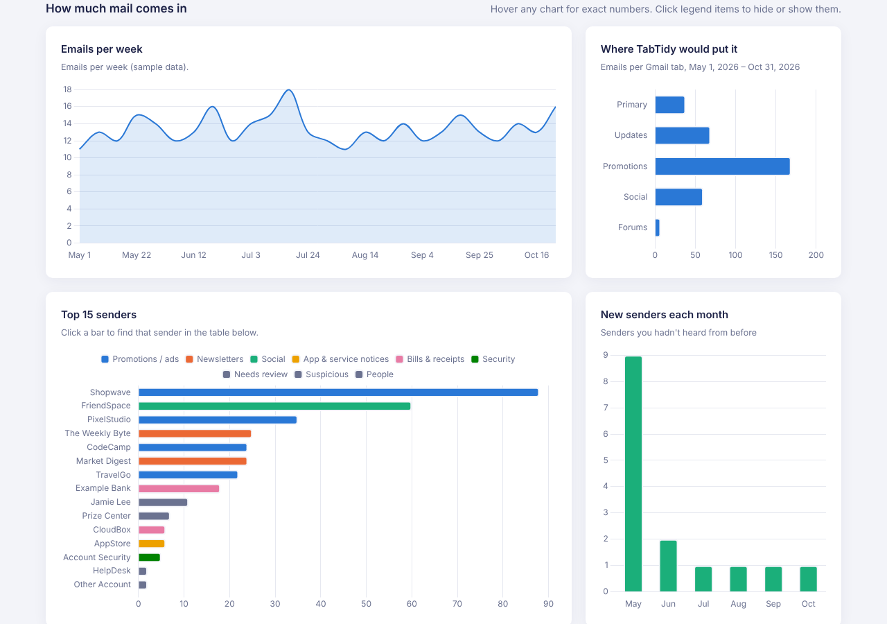
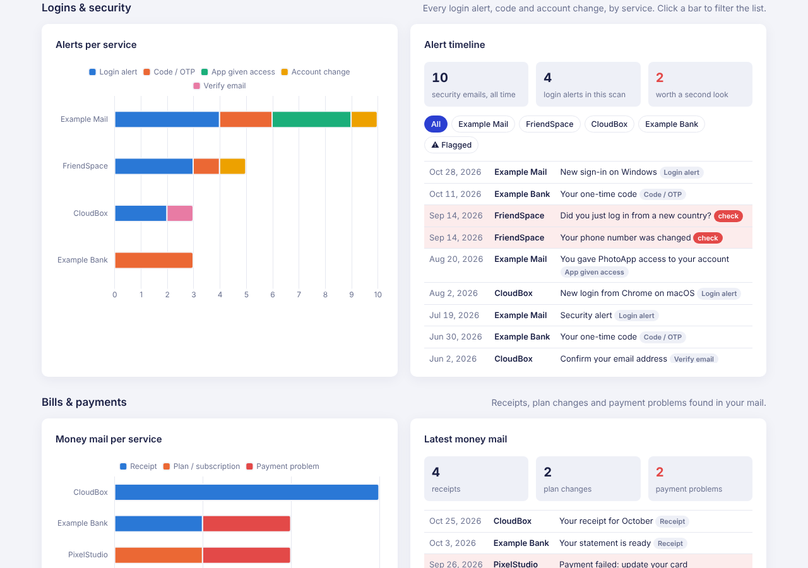
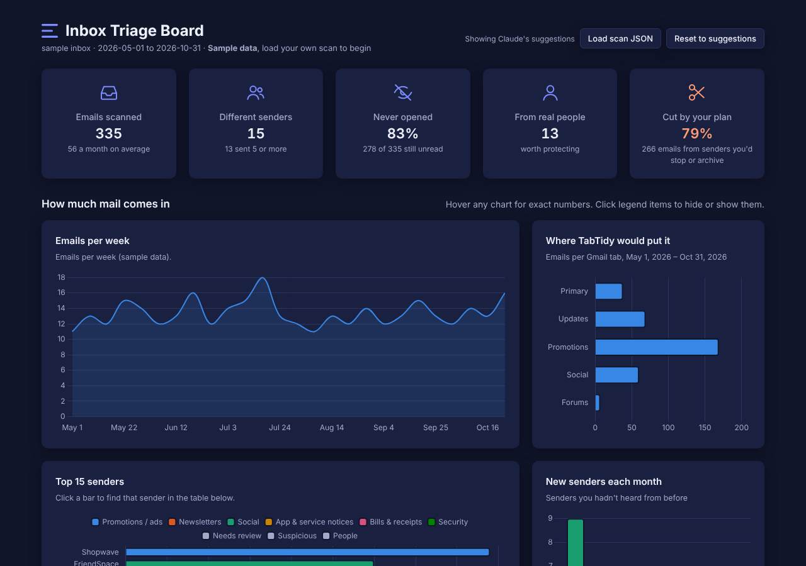

# 📬 TabTidy

**Your inbox is not a junk drawer. Let's make it act like one less.**

TabTidy helps you sort a Gmail inbox that's drowning in ads, notifications and "we miss you 🥺" emails, so **Primary** goes back to being what it was meant for: people, login codes, and things that actually need you.

It helps you:

- 💸 **find your bills**: receipts, invoices, and the "payment failed" email you definitely didn't miss for three months
- 🔔 **separate notifications**: app notices, newsletters and social pings each get a home
- 📢 **corral the ads** into one place, ready to unsubscribe from or delete in bulk
- 🚪 **unsubscribe** from the worst offenders, with one link per sender
- 🗑️ **delete** the junk, without throwing away a security alert by accident


<details>
<summary>📊 More screenshots: interactive charts, security & bills, dark mode</summary>





</details>

---

## 🤔 The problem

Most messy inboxes aren't full of spam. They're full of mail you *agreed to* once:

> *"Sign up to see the price"* → 4 emails a week for the rest of your life.

Spam filters let it through because it's legitimate. Then the email that matters (a bill, a security alert, a real human) gets buried under a promo for something you looked at once in 2023.

The tricky bits:

| Problem | Why it's hard |
|---|---|
| A few senders make most of the mess | You can't see that from inside the inbox |
| "Unwanted" is personal | One shop's promo is noise, another's you actually use |
| Companies mix important mail into the noise | The same app sends "50% off!" *and* "your payment failed" |
| Social networks hide security alerts among notifications | Delete all of them and you might trash "new login from another country" |

---

## 🛣️ Pick your path

|   | **Path 1 · Claude + Gmail** 🤖 | **Path 2 · Script + filters** ⚙️ |
|---|---|---|
| **Best for** | A one-time deep clean, with a dashboard | Set-and-forget sorting, no AI needed |
| **You need** | Claude with the Gmail connector | A Google account (that's it) |
| **What it does** | Scans, groups, builds a dashboard, sorts, unsubscribes, deletes | Sorts every new email into the right tab and label, on a schedule |
| **Effort** | Chat with Claude, approve each step | ~10 minutes setup, then nothing |
| **Guide** | [docs/path-1-claude-gmail.md](docs/path-1-claude-gmail.md) | [docs/path-2-script-and-filters.md](docs/path-2-script-and-filters.md) |

**Do both** for the best result: Path 1 cleans up the past, Path 2 keeps it clean.

---

## 🗺️ Where everything ends up

| Gmail tab | What lands there | Label |
|---|---|---|
| **Primary** | 👤 People you write to | — |
| | 🔐 Login codes, OTP, security alerts | Security & Account |
| | ⚠️ Payment failed, overdue, action required | Bills & Receipts |
| | 🏛️ Government and official | Official & Gov |
| | ✈️ Flight cancelled, schedule change | Travel & Bookings |
| **Updates** | 🧾 Receipts, invoices, bank and utility bills | Bills & Receipts |
| | 🔁 Plans, trials, renewals | Subscriptions |
| | 📦 Shipped, out for delivery | Orders & Deliveries |
| | 🎫 Bookings, e-tickets | Travel & Bookings |
| | 💼 Job alerts, applications | Jobs |
| | 📰 Newsletters and digests | Newsletters |
| | 🛠️ App, cloud and policy notices | Notices |
| **Promotions** | 🛍️ Sales, vouchers, "we miss you" | Ads & Promotions |
| **Social** | 💬 Social network notifications | Social |
| **Forums** | 🤷 Bulk mail nobody recognised yet | Review needed |

(Gmail only has those five tabs, so **Forums** doubles as the "Review needed" pile.)

---

## ⚡ Quick start

### Path 1: Claude + Gmail
1. In Claude, connect Gmail: **Settings → Connectors → Gmail**.
2. Follow the prompts in order: [`prompts/01-scan.md`](prompts/01-scan.md) → [`09-keep-clean.md`](prompts/09-keep-clean.md).

### Path 2: TabTidy script
Add the **TabTidy** library to your own Apps Script project:

```
Script ID: 1sj4sFD5amFGbVXBACvSlhsKh_RApKp3wfu7_1-1s6QHS1O-jAasOGwI7
Identifier: TabTidy
```

…or skip the library and copy-paste [`apps-script/TabTidy.gs`](apps-script/TabTidy.gs) into a new project. Full steps: [Path 2 guide](docs/path-2-script-and-filters.md).

---

## 📁 What's in the box

```
prompts/          9 step-by-step prompts for Claude (Path 1)
dashboard/        the triage dashboard: template, sample data, sample build
apps-script/      TabTidy.gs (the sorter) + Wrapper.gs (for library users)
filters/          ready-to-import Gmail filters + the generator script
tools/            build a local dashboard · check for personal data
docs/             guides, rules, data format, FAQ
```

---

## 🔒 Safe by design

- **Nothing is ever permanently deleted.** "Delete" means Gmail's Trash, which you can undo for 30 days.
- **Every step that changes Gmail asks first**, and works in small batches you can check.
- **TabTidy only adds labels and moves mail between tabs.** It never deletes, replies, forwards or clicks anything.
- **Your mail stays in Gmail.** Claude reads sender, subject and dates; TabTidy reads sender, subject and the unsubscribe header. Neither sends your mail anywhere else.
- **No personal data in this repo.** A check runs on every push to keep it that way.

Read more: [SECURITY.md](SECURITY.md).

---

## 🙋 FAQ & troubleshooting

"Could not create" when importing filters? The "unverified app" warning? See the [FAQ](docs/faq.md).

## 🤝 Contributing

Better regex? Your country's banks and couriers? A smarter dashboard? PRs welcome. See [CONTRIBUTING.md](CONTRIBUTING.md).

## 📜 License

[MIT](LICENSE). Use it, fork it, tidy everything.
