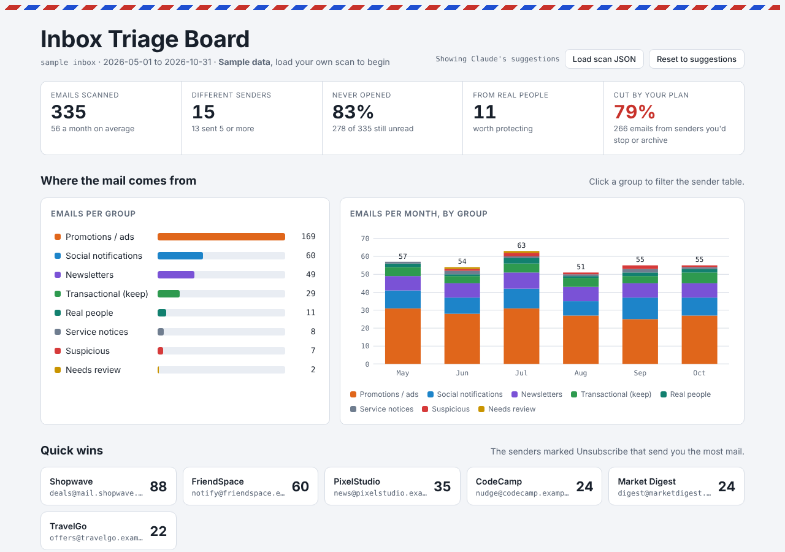

# Mail Inbox Manager

Clean up a Gmail inbox buried in ads and notifications, using Claude and a reusable triage dashboard. You scan, see where the clutter comes from, decide once per sender, and only then let Claude touch your mailbox.



## The problem

Most cluttered inboxes are not full of spam. They are full of mail you once agreed to: shop promotions, onboarding drips, newsletters, social notifications. Spam filters let it through because it is legitimate, and the mail that matters (bills, security alerts, real people) gets buried.

What makes it hard to fix by hand:

- **Volume is concentrated but invisible.** A few senders produce most of the clutter, and you cannot see that from inside the inbox.
- **"Unwanted" is personal.** One shop's promo is noise; another's you use.
- **Some automated mail matters.** Receipts, OTPs and security alerts look like clutter but must stay.
- **Unsubscribing is slow and sometimes risky.** One sender at a time, and suspicious senders treat a click as proof your address is live.

## What people have tried

| Approach | Limitation |
|---|---|
| Manual filters and rules | Tedious, one sender at a time. |
| Gmail's tabs (Promotions, Social, Updates) | Hide the mail without reducing it. |
| Bulk-unsubscribe services | Need full access to your mail; some have sold user data. |
| Paid inbox sorters | Subscription, and the rules are a black box. |

## This approach

Claude reads your inbox through Gmail's official connector with your own sign-in, groups **senders** (not individual emails), and suggests an action for each. You review everything in a dashboard. Nothing changes in Gmail until you confirm, and nothing is ever deleted; the strongest action is archive.

In practice a few dozen senders usually account for hundreds of emails, and a handful of them send most of it. Deciding once per sender is what makes the cleanup fast.

## Quick start

1. Connect Gmail in Claude: **Settings → Connectors → Gmail**.
2. Run the prompts in order. Each file says whether it changes your mailbox.

| Step | Prompt | Changes Gmail? |
|---|---|---|
| 1 | [Scan the inbox](prompts/01-scan.md) | No |
| 2 | [Group the senders](prompts/02-group.md) | No |
| 3 | [Build the dashboard](prompts/03-dashboard.md) | No |
| 4 | [Lock in your decisions](prompts/04-decide.md) | No |
| 5 | [Clean up, in batches](prompts/05-clean.md) | Yes, after you confirm |
| 6 | [Unsubscribe](prompts/06-unsubscribe.md) | No, you click |
| 7 | [Keep it clean](prompts/07-maintain.md) | Labels only |

## The dashboard

[`dashboard/index.html`](dashboard/index.html) is a single self-contained page that opens with fictional sample data. It shows:

- headline figures (emails, senders, never opened, from real people, how much your plan cuts)
- emails per group (click to filter) and per month, stacked by group
- quick wins: the busiest unsubscribe candidates
- a sortable, searchable sender table with a decision dropdown per sender
- an action plan with a **Copy Gmail search** button per action, and your decisions as JSON to hand back to Claude

Use it with your own data:

```bash
# Option A: open dashboard/index.html and click "Load scan JSON"
# Option B: bake your scan into a standalone page
python tools/build_dashboard.py my-scan.json -o my-dashboard.html
```

The JSON format is documented in [docs/data-schema.md](docs/data-schema.md). When Claude publishes the dashboard as an artifact (prompt 03), your decisions are saved with the artifact so Claude can read them back in prompt 04.

## Repository layout

```
prompts/        the seven step-by-step prompts
dashboard/      template.html, sample-data.json, index.html (sample build)
tools/          build_dashboard.py (scan JSON -> local dashboard), check_no_personal_data.py
docs/           how it works, grouping rules, data format
```

## Privacy and security

This repository holds **only** the method: prompts, documentation, a dashboard template and fictional sample data. It never holds anyone's mail.

- Your mail stays in Gmail. Claude reads sender, date, labels and a few subject lines, using your own Google sign-in.
- Your personal dashboard lives in your Claude account (as a private artifact) or on your own computer. It is never part of this repo.
- `.gitignore` blocks common scan and dashboard file names (`*.private.json`, `my-*.json`, `my-*.html`, `scans/`, `decisions.json`).
- `tools/check_no_personal_data.py` fails if any file contains a real-looking email address or scan output. It runs on every push and pull request (`.github/workflows/privacy-check.yml`); run it yourself before committing.
- Sample data uses reserved `.example` domains only.

## Roadmap

- Outlook / Microsoft 365 version of the prompts
- Per-sender read rate in the scan (when the connector exposes it cheaply)
- Gmail filter export (XML) from the dashboard's decisions
- More languages for the grouping rules

## Contributing

See [CONTRIBUTING.md](CONTRIBUTING.md). Improvements to the prompts, grouping rules and dashboard are all welcome.

## License

[MIT](LICENSE)
