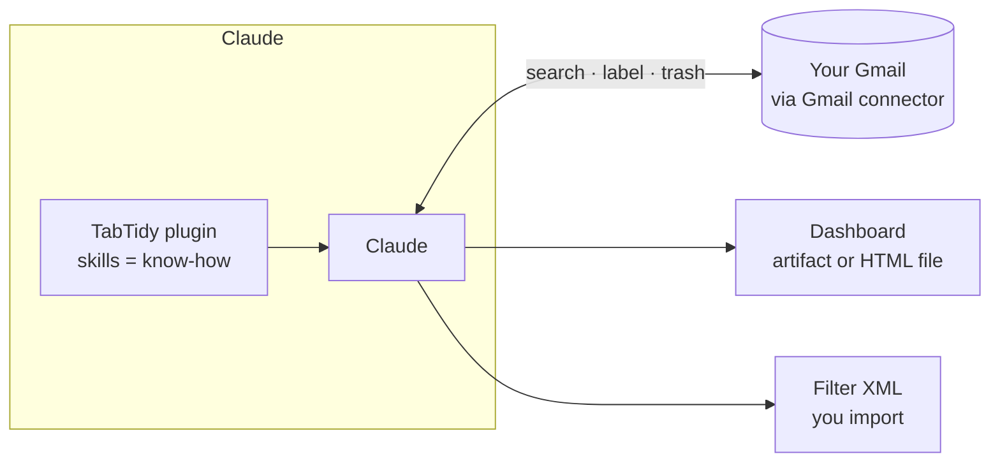

# TabTidy as a Claude plugin 🧩

Install TabTidy once, then just say **"tidy my inbox"** to Claude. The plugin teaches
Claude the whole TabTidy method (scan, group, dashboard, sort, unsubscribe, delete,
keep clean), so you no longer copy-paste nine prompts.

---

## 1 · The big picture

### The problem it solves
Your inbox is full of mail you once agreed to. A few senders make most of the mess, bills
and security alerts hide among the noise, and cleaning it by hand means thousands of
tiny decisions.

### How the plugin solves it
**Decide once per sender, not once per email.** Claude reads *who* sends you *how much*
(not your message bodies), groups the senders, lets you decide, then acts in small,
confirmed batches.



Three pieces work together:

| Piece | What it is | Who provides it |
|---|---|---|
| **Gmail connector** | Claude's official, sign-in-with-Google access to your mailbox | Claude (you connect it once) |
| **TabTidy plugin** | A set of *skills*: written recipes Claude follows, plus the dashboard template, filter files and script | This repository |
| **Marketplace** | A small catalogue file (`.claude-plugin/marketplace.json`) that tells Claude where the plugin lives | This repository |

### What the plugin can and can't do

| Can | Can't |
|---|---|
| Read sender, subject, date | Send, reply or forward email |
| Add labels, move mail between tabs | Empty Trash or delete permanently |
| Move mail to Trash (undo for 30 days), mark spam, **after you OK it** | Click unsubscribe links (you do) |
| Write Gmail filter files | Create filters inside Gmail (you import them) |

---

## 2 · Before you start (2 minutes)

You need:

1. **Claude** with plugin support: the **Claude desktop app** (Cowork) or **Claude Code**.
2. **The Gmail connector** connected to the same Claude account:
   claude.ai → **Settings → Connectors → Gmail → Connect** → sign in with Google → **Allow**.
3. (Optional, for Claude Code only) Python 3, to build the dashboard as a local file.

---

## 3 · Install, step by step

### Option A · Claude desktop app (Cowork)

1. Open the Claude desktop app and go to the place where you manage plugins
   (**Customize / Plugins**), then choose **Add marketplace**.
2. In the **URL** box type:
   ```
   sujeshshivan/TabTidy
   ```
3. Leave **Sync automatically** on if you want updates when this repo changes.
4. Click **Add**. Claude now finds `.claude-plugin/marketplace.json` in the repo.
5. In the list of plugins from that marketplace, find **tabtidy** → **Install**.
6. Start a new task/chat so the plugin is loaded.

> Saw **"This repository isn't a marketplace — no manifest found at
> .claude-plugin/marketplace.json"**? That means the version of the repo you added
> doesn't have the plugin yet (it was added in the pull request that created this
> guide). Once that pull request is merged into `main`, add the marketplace again.

### Option B · Claude Code (terminal)

```text
/plugin marketplace add sujeshshivan/TabTidy
/plugin install tabtidy@tabtidy
```

Or, on Claude Code 2.1.275 and later, in one line:

```text
/plugin install tabtidy --marketplace sujeshshivan/TabTidy
```

Then restart Claude Code (or run `/reload-plugins`). Check it worked with `/plugin` →
**Installed**: you should see **tabtidy**.

> Want to try it before the pull request is merged? Add the branch instead:
> `/plugin marketplace add sujeshshivan/TabTidy#claude/project-thread-1iveb8`

### Check the install

Ask Claude: **"What TabTidy skills do you have?"** It should list the skills in the
table below. Then: **"Scan my Gmail, read-only"**. If it says Gmail isn't connected, go
back to step 2.

---

## 4 · Use it, step by step

You can talk naturally ("find my bills") or call a step directly with a slash command
(`/tabtidy:find-bills`). The easiest start is:

```text
/tabtidy:tidy-inbox
```

Claude walks you through every step below and stops after each one for your OK.

| # | Say this… | …or type | What happens | Changes Gmail? |
|---|---|---|---|---|
| 1 | "Scan my inbox for the last 6 months" | `/tabtidy:scan` | Counts mail per sender per month, unread, tabs; spots payment problems | No |
| 2 | "Group my senders" | `/tabtidy:group` | Every sender → one group + one suggested action | No |
| 💸 | "Find my bills" | `/tabtidy:find-bills` | Payment problems first, then subscriptions, then receipts | No |
| 3 | "Show me a dashboard" | `/tabtidy:dashboard` | Interactive dashboard with charts and a decision per sender | No |
| 4 | "My decisions are ready" | `/tabtidy:decide` | Final list per action, saved for the next steps | No |
| 5 | "Sort my inbox into tabs" | `/tabtidy:sort-into-tabs` | Labels + tabs; one test sender (≤20 emails) first | Labels & tabs only |
| 6 | "Give me the unsubscribe links" | `/tabtidy:unsubscribe` | One link per sender; **you** click | No |
| 7 | (type it, Claude won't start this alone) | `/tabtidy:delete-junk` | Counts, protects security & payment mail, waits for OK, then Trash | Trash (undo 30 days) |
| 8 | "Make Gmail filters for this" | `/tabtidy:filters` | Gives you XML files to import | Only when you import |
| 9 | "Keep my inbox clean" | `/tabtidy:keep-clean` | Weekly Claude check, or the TabTidy script | Labels & tabs only |

### A typical first session (about an hour, mostly you deciding)

1. `/tabtidy:tidy-inbox`
2. Read the scan summary. Deal with any **payment failed** emails first.
3. Look at the grouped table or dashboard. Change anything you disagree with.
4. Say **"OK, sort them"**. Check the test sender in Gmail, then say **"OK, do the rest"**.
5. Click the unsubscribe links Claude lists.
6. Type `/tabtidy:delete-junk`. Read the "will NOT be deleted" list, then say **OK**.
7. Import the two filter files, or install the TabTidy script, so it stays clean.

### Files Claude keeps for you

| File | Holds |
|---|---|
| `tabtidy-scan.json` | Senders, counts, groups, suggested actions |
| `tabtidy-decisions.json` | Your final decision per sender |
| `tabtidy-dashboard.html` | The dashboard, if it wasn't published as an artifact |

They contain your mail data. They stay on your computer / in your Claude workspace and
are already in this repo's `.gitignore`. Don't share them.

---

## 5 · How it's built (for the curious)

```
.claude-plugin/marketplace.json        ← the catalogue Claude reads when you "add marketplace"
plugins/tabtidy/
  .claude-plugin/plugin.json           ← the plugin's name, version, author
  .claude-plugin/icon.png
  skills/
    tidy-inbox/SKILL.md                ← the guide that runs all steps in order
    scan/  group/  find-bills/  dashboard/  decide/
    sort-into-tabs/  unsubscribe/  delete-junk/  filters/  keep-clean/
      SKILL.md                         ← the recipe for that step
      assets/ references/ scripts/     ← files the recipe uses (template, rules, XML, script)
```

- A **skill** is a Markdown file with a short `description` at the top. Claude reads every
  description, and when your request matches one ("find my bills"), it loads that
  skill's full recipe and follows it. Each skill is also a slash command:
  `/tabtidy:<skill-name>`.
- `delete-junk` has `disable-model-invocation: true`, so Claude **never starts deleting on
  its own**; only your typed command starts it.
- The plugin doesn't ship its own Gmail access. It uses the **Gmail connector** you
  connected, which runs on Google's official API with your own sign-in.
- The plugin is installed on its own, so it carries copies of the dashboard template,
  rulebook, data format, filter files and Apps Script. `tools/sync_plugin.py` refreshes
  those copies, and CI fails if they drift.

## 6 · Updating and removing

- **Update:** with "Sync automatically" on, the desktop app picks up changes. In Claude
  Code: `/plugin marketplace update tabtidy`.
- **Remove:** uninstall **tabtidy** from the plugins list (Claude Code:
  `/plugin uninstall tabtidy@tabtidy`). Your Gmail labels and mail are untouched.
- **Cut Gmail access:** claude.ai → Settings → Connectors → Gmail → Disconnect.

## 7 · Troubleshooting

| Problem | Fix |
|---|---|
| "no manifest found at .claude-plugin/marketplace.json" | The plugin isn't on `main` yet; merge the plugin pull request, then add the marketplace again. |
| Claude says it can't access Gmail | Connect the Gmail connector (section 2) and start a new chat. |
| The `/tabtidy:` commands don't appear | Restart the app / Claude Code after installing; check the plugin is enabled. |
| The scan total is lower than Gmail's | Ask Claude to re-split date windows that returned exactly 50. |
| Sorting thousands of emails is slow | Claude gives you a Gmail search for big groups; bulk-select in Gmail instead. |
