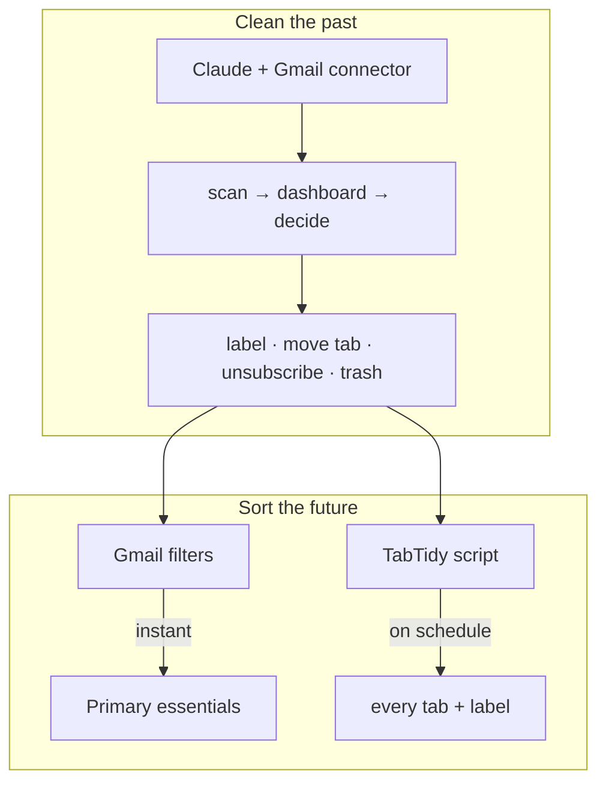

# How it works 🔧

## The idea in one line

**Decide once per sender, not once per email.** A typical inbox has hundreds or thousands of emails but only a few dozen senders, and a handful of them send most of it.

## Three layers

| Layer | Runs | Good at | Can't |
|---|---|---|---|
| **Claude + Gmail** | When you chat | Understanding context, dashboards, one-off cleanups | Create filters; it's slow for thousands of single changes |
| **Gmail filters** | Instantly | Must-see alerts the second they arrive | Regex; tab moves other than Primary (on import) |
| **TabTidy** | Every N minutes/hours/days | Regex rules, all five tabs, one home per email | React instantly (no "new mail" signal) |

## How TabTidy decides

For each unsorted email, top to bottom:

1. **You replied in this conversation?** → Primary. It's a real conversation.
2. **Sender in `alwaysPrimary`?** → Primary. In `alwaysPromotions`? → Promotions.
3. **Rules, first match wins:** security → payment problems → government → flight changes → bills → orders → travel → subscriptions → jobs → notices → social → newsletters → ads.
4. **Nothing matched?**
   - Mass mail (has an unsubscribe header) → **Forums**, labelled **Review needed**
   - Anything else (probably a person) → **Primary**, no label
5. Add the hidden **Sorted** label so it's never re-sorted.

Order matters: security comes first, so a "new login" email from a social network lands in Primary, not Social. Newsletters come before ads, so a digest isn't treated as a promo.

## Lessons from real cleanups 📚

- **Bills hide among ad senders.** The same company sends promos *and* "payment failed". Sort by subject, not just sender.
- **Security alerts hide among notifications.** Social networks send login alerts from a sibling address (`security@…`). Check before bulk-deleting.
- **Searches cap at 50 per page.** Scan in small date windows or you'll miss mail.
- **Filter import is picky.** "Categorize as Primary" works; other tabs fail. Hence TabTidy.
- **Unread rate says a lot.** When 99% of an inbox is unread, volume (not read rate) tells you what to cut.

## Where your data lives

| Thing | Where |
|---|---|
| Your emails | Gmail. Never copied anywhere by this project. |
| Scan JSON | Your Claude chat, or a file on your computer. Keep it out of git. |
| Dashboard decisions | The Claude artifact's private storage, or your browser's local storage. |
| TabTidy's state | Labels in your Gmail. That's it. |
