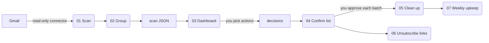

# How it works

## The flow

Steps 01 to 04 only read. Step 05 is the first that changes Gmail, and it works in small confirmed batches.

## Why per-sender, not per-email

A typical inbox has hundreds of emails but only a few dozen senders, and a handful of them send most of the mail. It is common for every one of the busiest senders to be automated. Deciding once per sender turns hundreds of choices into a few dozen.

## Why the Gmail connector

- It runs with your own Google sign-in. No third-party unsubscribe service gets access to your mail.
- Claude can search, read metadata, label, archive and mark spam.
- It cannot create Gmail filters, so permanent auto-sorting is done either by the weekly task (prompt 07) or by pasting the dashboard's Gmail search into Gmail's **Create filter**.

## Scanning limits to know about

- A search returns at most 50 threads per page. The scan prompt splits the date range into windows that each stay under 50, so nothing is silently dropped.
- Counts are **threads**, not individual messages. For bulk mail these are almost always the same.
- Gmail's result counts are estimates; small differences against the scan total are normal.

## Where your data lives

| Thing | Where |
|---|---|
| Your emails | Stay in Gmail. Claude reads metadata (sender, date, labels, a few subject lines). |
| Scan JSON | In your Claude conversation, or on your computer if you save it. Keep it out of git. |
| Dashboard decisions | Claude artifact: the artifact's private database. Local file: your browser's local storage. |
