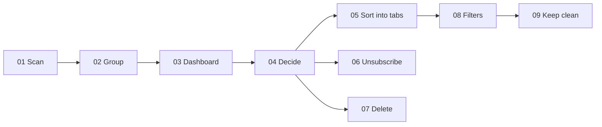
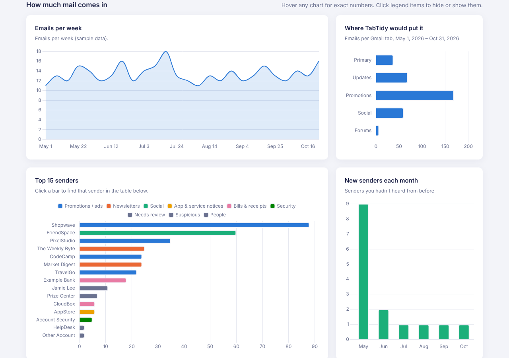
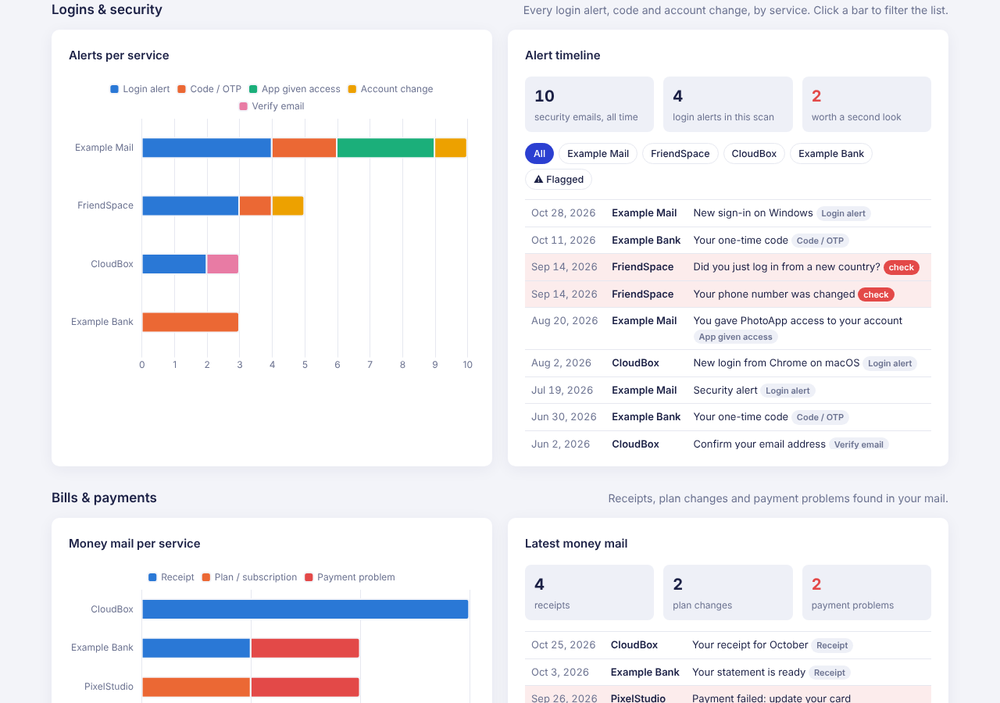

# Path 1 · Claude + Gmail 🤖

A guided deep clean: Claude reads your inbox, shows you a dashboard, and does the sorting, unsubscribing and deleting with you, one confirmed step at a time.

**You need:** Claude (web, desktop or mobile) with the **Gmail connector**.
**Time:** about an hour for the first full clean, mostly you deciding.

---

## The big picture

Steps **01–04 only look**. Steps **05–07 change Gmail**, in small batches, after you say OK.

---

## Step 0 · Connect Gmail

1. In Claude, open **Settings → Connectors**.
2. Find **Gmail** → **Connect** → sign in with Google → allow access.
3. Start a new chat. Claude can now search and label your mail. It **cannot** create Gmail filters, empty Trash, or send email without asking.

---

## Step 1 · Scan 🔍 · [prompt](../prompts/01-scan.md)

Claude counts who sends you what, month by month. Read-only.

**You'll learn:** total emails, how many are unread (spoiler: most), the top 10 senders, and any **payment problems** hiding in there.

> 💡 Searches return at most 50 conversations per page, so the prompt scans in small date windows. If a window returns exactly 50, ask Claude to split it, or you'll miss mail.

## Step 2 · Group 🗂️ · [prompt](../prompts/02-group.md)

Every sender goes into one group (security, bills, orders, newsletters, social, promotions…) with a suggested action.

> 💡 Watch for companies that send **both** ads and bills. Group those by subject, not by sender.

## Step 3 · Dashboard 📊 · [prompt](../prompts/03-dashboard.md)

Claude exports the scan as JSON and turns it into a dashboard:

- headline numbers
- emails per week, per Gmail tab, per group and per month
- top 15 senders (click to jump to one) and new senders per month
- logins & security per service, with risky alerts flagged
- bills & payments, with payment problems in red
- quick wins (the busiest senders to unsubscribe from)
- a sender table with a decision dropdown each
- Gmail searches you can copy, per action

Two ways to get it:

| Option | How | Decisions saved |
|---|---|---|
| **Claude artifact** | Claude publishes the page for you | With the artifact, so Claude can read them back |
| **Local file** | `python tools/build_dashboard.py my-scan.json -o my-dashboard.html` | In your browser; use **Copy decisions** to hand them back |

Format of the JSON: [data-schema.md](data-schema.md). Try it with fake data first: open [`dashboard/index.html`](../dashboard/index.html). Charts are interactive: hover for numbers, click legend items to hide or show a series.

## Step 4 · Decide ✅ · [prompt](../prompts/04-decide.md)

Click through the dashboard, change what you disagree with, then let Claude read back the final list. Still nothing changes in Gmail.

## Step 5 · Sort into tabs 🏷️ · [prompt](../prompts/05-sort-into-tabs.md)

Claude adds labels and moves mail into the right tab. It does one sender first (max 20 emails) so you can check, then the rest.

> 💡 **Big inbox?** The connector changes one conversation at a time. For hundreds, Claude gives you a Gmail search instead, and you bulk-select in Gmail: select all → **Select all conversations that match** → label → right-click → **Move to tab**.

## Step 6 · Unsubscribe 🚪 · [prompt](../prompts/06-unsubscribe.md)

Claude lists one unsubscribe link per sender. **You click them.** Links inside emails are your call, never Claude's.

> 💡 For social networks, turn off email in the app's **Settings → Notifications → Email**. One switch beats twenty links.

## Step 7 · Delete 🗑️ · [prompt](../prompts/07-delete.md)

Claude counts, checks for security and payment mail from the same companies, waits for your OK, then moves the rest to **Trash** (undo-able for 30 days).

## Step 8 · Filters ⚙️ · [prompt](../prompts/08-filters.md)

Make it automatic. Import the ready-made filter files, or let Claude add your own senders to them.

## Step 9 · Keep clean 🧹 · [prompt](../prompts/09-keep-clean.md)

A weekly Claude check-in, or install **TabTidy** ([Path 2](path-2-script-and-filters.md)) and forget about it.

---

## Golden rules 🏅

1. **Look before you touch.** Scan → dashboard → decide, *then* act.
2. **Small batch first.** Check 20 emails in Gmail before doing 2,000.
3. **Archive or label beats delete.** Deleted mail is gone after 30 days.
4. **Never bulk-delete a company's mail without checking for security alerts.**
5. **You click unsubscribe links, not Claude.**
6. **Your scan file is personal.** Keep `my-*.json` out of git.
